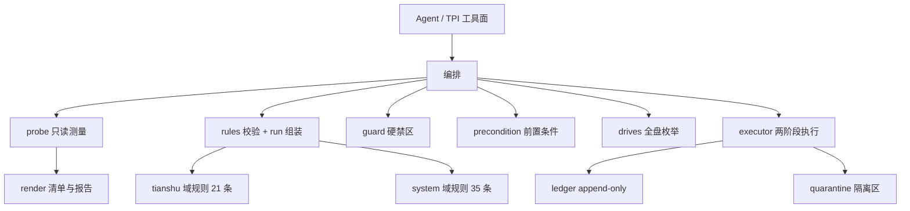

# TianShu-Februus

**天枢（Tianshu）插件 `disk-steward`（磁盘管家）**：把「清理磁盘」做成一条可审计的流水线 —— 扫描 → 分级并逐项解释 → 人勾选 → 两阶段执行 → 每一步落台账、可撤销。

扫描只读。任何真正的删除都必须先经过人工确认；任何「能删」的判断都必须能说出理由；任何「不删」的东西也必须说清为什么。

这是内部原型的公开镜像（工作区代号 `Februus`），代码即文档：不变量有对应的测试，断言失败就是设计被破坏。

---

## 三条不变量

1. **无执行器即被拒** —— `item.executor` 为 `null` 的项永远进不了清理计划。
2. **只有 `stage | migrate` 进清理集** —— `compact` 只压实不动文件，把它移入隔离区等于破坏活数据库。
3. **人批准是独立事实** —— 一次性令牌只是能力凭证，`issuer === 'human'` 且 `confirmedBy` 非空才允许动磁盘。

规则库刻意是**白名单**：只列能解释清楚的路径，不用通配符扫系统目录。清单之外的路径，插件的诚实回答是「不认识，所以不动」。

## 它能做什么

| 能力 | 说明 |
|---|---|
| 双域扫描 | **tianshu 域**（`~/.rivet` 与项目 `.rivet` 下的 scratch/临时区/缓存/备份/历史产物）+ **system 域**（`%TEMP%`、`%LOCALAPPDATA%` 下的包管理器缓存、应用缓存、崩溃转储、浏览器缓存等） |
| 全部盘画像 | 枚举设备上每个逻辑盘的容量与顶层条目，可选占用排序（只读，不授予执行资格） |
| 逐项解释 | 每一项回答「这是什么、多大、删了会怎样、能不能重建、撤销方式」 |
| 分级 | `green`（纯缓存，重建即可）/ `yellow`（会触发重建成本）/ `brown`（受保护，永不执行） |
| 两阶段执行 | `stage` 移入隔离区（可撤销）→ 人工确认后 `purge` 永久删除 |
| 台账 | append-only `ledger.jsonl`，每项记录 `from`/`to`/字节数/批准来源，可按批次反演 |
| 硬禁区 | 10 类路径（`WINDOWS_DIR`、`PROGRAM_FILES`、`PROGRAMDATA`、`USER_DOCS`、`PAGE_HIBER`、`RECYCLE_BIN`、`VSS`、`CRYPTO`、`WINSXS`、`UNC`）走 realpath 复核后拒绝 |
| 前置条件 | 进程未运行 / 服务已停止 / 文件不存在才允许执行，无法判定即 fail-closed |

## 架构



分层职责：**probe / drives 只读测量 → rules / run 纯函数分级与组装 → plan 闸门 → executor 唯一有写权限**。规则与执行器分离，「该不该」与「怎么做」互不纠缠。

## 快速开始

运行代码零依赖（Node.js ESM，实测 Node 24）。类型检查依赖仓库根的 `typescript` 与 `@types/node`。

```bash
cd disk-steward

# 测试：259 用例 / 58 个文件
npm test                        # 等价于 node --test
node --test test/w36.test.mjs   # 单文件

# 只读扫描 + 文本面板（参数是项目根，用于解析 {{projectRivetHome}}）
node bin/scan.mjs ..

# 交互面板：勾选 → 预览计划 → 确认 → 执行 → 撤销
node bin/tui.mjs --with-system --allow-exec

# 隔离区：查看 / 人工永久删除
node bin/purge.mjs
node bin/purge.mjs --batch <batchId> --yes --by <你的名字>

# 崩溃后补齐台账（只改记录，不动磁盘；不给 --batch 则列出未决批次）
node bin/recover.mjs
```

作为天枢插件加载时，入口是 `index.js`（`defineTianshuPlugin({ id: 'disk-steward', activate })`），宿主注入 `storage.dataDir()` 决定台账与隔离区位置；非宿主调用（`bin/` 下的 CLI、测试）落在 `%USERPROFILE%\.rivet\plugins\disk-steward\data`。

## 工具面（9 个）

| 工具 | 只读 | 作用 |
|---|---|---|
| `disk_scan` | ✅ | 扫描并落盘一次 run，返回 `run_id` 与最大 20 项；不写用户数据，默认脱敏样本文件名 |
| `disk_status` | ✅ | 全部盘容量与已用率 + 关键目录存在性 + 隔离区状态（不递归遍历） |
| `disk_rules` | ✅ | 解释某路径命中哪条规则、为什么是该分级 |
| `disk_report` | ✅ | 把一次扫描渲染成 Markdown 清单（逐项域标注与 id） |
| `disk_diff` | ✅ | 两次扫描的增量（变大/变小/新增/消失），分项之和等于总量差 |
| `disk_plan` | ✅ | 生成计划并签发一次性令牌；保护项 / 被挡项 / 引用过期一律拒绝 |
| `disk_exec` | ❌ | `stage` 移入隔离区（可撤销）/ `purge` 永久删除；必须带用户批准的证据 |
| `disk_undo` | ❌ | 按批次反演撤销；目标已存在则跳过并说明，不猜测 |
| `disk_recover` | ✅ | 崩溃恢复：补齐「只写了 intent、终态行没落」的批次账目。只改台账，不动磁盘，因此不需批准；不给 `batchId` 则列出未决批次 |

「人批准过」这个事实由**对话**提供：`disk_plan` 以 `issuer: 'agent'` 签发；agent 先把计划逐项给用户看，用户明确同意后把其原话作为 `approval` 传给 `disk_exec`。宿主提供了会话记录（`host.transcripts`）时，工具层会核对原话是否真出自用户；拿不到记录时一律 fail-closed。

## 仓库结构

```
disk-steward/
  index.js                 # 宿主入口：defineTianshuPlugin
  tools/index.mjs          # 工具面：scan/status/rules/report/diff/plan/exec/undo
  core/                    # 只读测量、规则校验、引用图、硬禁区、前置条件、
                           # 计划与令牌、执行器、身份快照、台账、增量、提权判定
  domains/                 # tianshu 域 / system 域 / 全盘扫描
  render/                  # 文本面板、TUI 状态机、确认页、Markdown 报告
  rules/tianshu.rules.json # 天枢域规则（白名单）
  bin/                     # scan.mjs / tui.mjs / purge.mjs
  test/                    # 259 用例 / 58 个文件
  dist/                    # 发行目录，由 scripts/pack-release.mjs 生成（不入库）
docs/                      # 架构设计、生态调研、边界对照
```

## 实测状态（2026-11-17 现场核对）

| 项 | 数值 | 怎么核 |
|---|---|---|
| 测试 | **259 用例 / 58 个文件，全绿**（`pass 259 / fail 0`，约 140s） | `npm test` |
| 工具 | **9** 个 | `createTools().length` |
| 规则 | 天枢域 **21** 条（stage 12 / compact 2 / protected 7）、系统域 **35** 条 | `rules/tianshu.rules.json`、`domains/system.mjs` |
| 硬禁区 | **9** 类 | `core/guard.mjs` 的 `DENY` |
| 代码量 | **81 个 `.mjs` / 7287 行**（含测试；生产代码 31 个文件） | `find` + `wc -l` |

真机一次系统盘清理的实测记录：扫描出 13 项可执行候选 17.92 GB，实际清理 6 项，**C 盘可用空间 79.3 GB → 95.2 GB**。其中 1 项（缩略图缓存）因 `rename` 报 `EPERM`（被 explorer 占用）被跳过，台账留下 `abort` 记录 —— 插件不会为了「清理干净」去动正在使用的目录。

## 平台与已知限制

- **Windows 优先**：`system` 域规则基于 Windows 路径语义；非 Windows 平台上前置条件探测返回 `unknown` 并按 fail-closed 处理（不执行）。
- **Node.js >= 22**（`package.json` 的 `engines`）：引用图用到 `node:sqlite`，盘符枚举用到 `fs.statfs`。
- **只在天枢宿主内可完整运行**：`index.js` 需要宿主注入 `globalThis.__tianshuTPI`，否则直接抛错；CLI（`bin/`）是独立的非宿主路径。
- **批准证据的强度**：CLI 路径下没有宿主会话记录，`approvalEvidence` 为空时执行类工具会 fail-closed；TUI 与 `bin/purge.mjs` 由本地人当场键入提供批准事实。工具面的 `approval` 通道挡得住「模型没问就执行」，挡不住「模型编一句批准」——机器可验证的批准需要宿主批准 UI 支撑。
- **未在 macOS / Linux 实测**。

## 文档

- `docs/架构设计-disk-steward-双域磁盘清理插件.md` —— 不变量台账、分层架构、状态机、验收清单
- `docs/系统流畅度与磁盘清理插件调研报告.md` —— 生态与架构调研（规则库实测、五级分级模型）
- `docs/调研补充-系统磁盘清理应用与边界对照.md` —— 五种规则库格式对照、共识禁区与分歧区
- `disk-steward/README.md` —— 实现级细节（规则库格式、台账格式、隔离区策略、宿主加载契约）

## 许可

[MIT](LICENSE)
