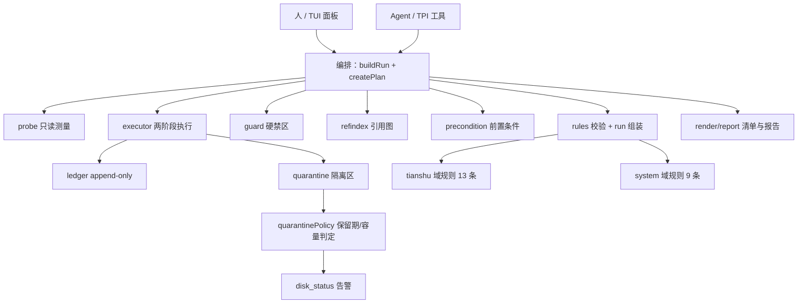

# disk-steward · 磁盘管家

天枢（Tianshu）插件：**把"清理磁盘"做成一条可审计的流水线** —— 扫描 → 分级并逐项解释 → 人勾选 → 两阶段执行 → 每一步落台账、可撤销。

扫描只读。任何真正的删除都必须先经过人工确认；任何"能删"的判断都必须能说出理由；任何"不删"的东西也必须说清为什么。

## 核心立场（三条不变量）

1. **无执行器即被拒**：`item.executor` 为 `null` 的项永远进不了计划。
2. **只有 `stage | migrate` 进清理集**：`compact` 只压实不动文件，把它 stage 走等于破坏活数据库。
3. **人批准是独立事实**：令牌只是能力凭证，`issuer === 'human'` 且 `confirmedBy` 非空才允许动磁盘。

## 双域

| 域 | 管什么 | 执行资格从哪来 |
|---|---|---|
| **tianshu** | 天枢自身的数据（`~/.rivet` 与项目 `.rivet`）：记忆库、知识库、计划、技能、备份、历史产物 | 规则文件直接声明 `executor` |
| **system** | 操作系统侧的缓存与临时区（`%TEMP%`、`%LOCALAPPDATA%\Temp`、`%WINDIR%\Temp`、Chrome/Edge 缓存、`WinSxS`、回收站） | `scanSystem({ execEnabled: true })` 授予；工具面已开启，TUI 需 `--with-system --allow-exec` |

规则库刻意是**白名单**：只列能解释清楚的路径，不用通配符扫系统目录。看到清单之外的路径，插件的诚实回答是"不认识，所以不动"。

---

## 当前状态（每个数字都可复核）

| 项 | 数值 | 怎么核 |
|---|---|---|
| 工具 | **8** 个 | `createTools()` 返回长度；见「工具面」节 |
| 测试 | **161 用例 / 36 个文件**，全绿 | `npm test`（`scripts.test = node --test`）或 `node --test test/*.test.mjs` |
| 类型检查 | `tsc --noEmit` **exit 0**（`allowJs` + `checkJs` + `noEmit`） | `../node_modules/.bin/tsc --noEmit` |
| 规则 | 天枢域 **13** 条、系统域 **9** 条 | `rules/tianshu.rules.json`、`domains/system.mjs` |
| 代码量 | **61 个 `.mjs` / 5364 行**（含测试） | `find . -name '*.mjs' -not -path './node_modules/*' -print0 \| xargs -0 cat \| wc -l` |
| 真实台账 | **49 行 / 4 批**：`intent` 16、`stage` 16、`batch` 4、`undo` 1、`purge` 12，purge 合计 **831,770,235 字节** | `<插件目录>/.runs/ledger.jsonl` |
| 安装位置 | 仅一处：`D:\Tianshu\TianshuData\.rivet\plugins\disk-steward\`（桌面端 4.0.1 加载这里） | 该目录 `.runs/` 会随工具调用出现新文件 |

---

## 快速开始

工作目录 `disk-steward/`。运行代码零依赖；类型检查依赖仓库根的 `typescript` 与 `@types/node`。

```bash
# 测试（161 用例 / 36 文件）
npm test                       # 等价于 node --test
node --test test/w19.test.mjs  # 单文件

# 类型检查
../node_modules/.bin/tsc --noEmit

# 只读扫描 + 文本面板（参数是项目根，用于解析 {{projectRivetHome}}）
node bin/scan.mjs D:/Februus

# 交互面板：勾选 → 预览计划 → 确认 → 执行 → 撤销
node bin/tui.mjs --only-project                # 只展示项目域条目
node bin/tui.mjs --only-project --allow-exec   # 允许真正 stage（仍需 x→y 二次确认）
node bin/tui.mjs --with-system --allow-exec    # 连系统域一起（默认关闭）
node bin/tui.mjs --script "axy"                # 无人值守回放按键（_ 代表空格）
node bin/tui.mjs --project D:/somewhere        # 指定项目根

# 隔离区：查看 / 人工永久删除
node bin/purge.mjs                                       # 打印批次数、项数、体积、最老天数
node bin/purge.mjs --batch <batchId>                     # 交互确认 [y/N] 后永久删除
node bin/purge.mjs --batch <batchId> --yes --by <name>   # 跳过交互（显式署名）
```

TUI 按键：`j/k` 移动 · `空格` 勾选 · `a` 全选可勾项 · `c` 清空 · `f` 循环过滤（全部/可勾/受保护/被挡）· `d` 详情 · `p` 预览计划 · `x` 进入确认页 · `y` 确认执行 · `n` 取消 · `u` 撤销本会话批次 · `q` 退出。

---

## 安全模型

```
无执行器即被拒：item.executor 为 null 的项永远进不了计划
   ↓ 天枢域由规则声明 executor；系统域由 scanSystem({ execEnabled: true }) 授予资格
只有 stage / migrate 进清理集（compact 只压实不动文件）
   ↓ 用户勾选 → 预览计划 → x 进确认页 → y 确认
stage：移入隔离区（同卷 rename；跨卷自动退化为复制+删，标 crossVolume）
   ↓ 再次确认 + 一次性令牌 + 已 staged 校验
purge：永久删除，只限本批次已 staged 的项
```

- **令牌**：`createPlan` 签发，10 分钟 TTL；`stage` 与 `purge` 都校验令牌与过期时间，令牌一次性。
- **人工批准**：`stage` / `purge` / `purgeBatch` 要求 `issuer === 'human'` 且 `confirmedBy` 非空。工具面通过 `disk_exec` 的 `approval` 取得这一事实；TUI 与 `bin/purge.mjs` 由本地键入提供。
- **计划拒绝条件**（`core/plan.mjs`）：保护项（brown）/ 无执行器 / 非 `stage|migrate` / 被挡（`active`、`precondition`、`excluded`）/ **引用结论已过期**（`refsStaleSeconds > 0`）。
- **硬禁区**（`core/guard.mjs`，9 类，优先级高于规则库与用户决定）：Windows 系统目录、`Program Files*`、`ProgramData`、用户个人目录（文档/桌面/图片/视频/音乐/下载/OneDrive/AppData\Roaming）、`pagefile.sys`/`hiberfil.sys`/`swapfile.sys`、`$Recycle.Bin`、`System Volume Information`（卷影副本）、任意层 `WinSxS`、`Crypto\Keys` / `Microsoft\Protect`。字符串判定之外，执行前还会 `realpath` 解析真实路径再判一次（堵软链/junction）。
- **活跃窗口**：10 分钟内有写入（`mtimeGuard`）的项标记 `blocked: 'active'`，不进计划。
- **前置条件 fail-closed**：`processNotRunning` / `serviceStopped` / `fileExists` 不满足即阻塞；不认识的类型一律不通过。
- **执行期重验**：stage 前对每个目标取 dev+ino+size+mtime 快照，与扫描时对比；移动后再比一次，不符即回滚并记 `abort`。
- **引用图**：产物按 `expand: 'refs'` 展开为节点，被引用数决定分级；任何来源不可读 → 节点标 `refScanIncomplete` → **永不判 green**。增量索引 60s TTL，过期秒数写进 item，plan 层据此拒绝（遇到 `PLAN_REFUSED_STALE_REFS` 说明该重新扫描，删 `<插件目录>/.runs/refcache.json` 可强制重建）。

---

## 架构



分层职责：**probe 只读测量 → rules/run 纯函数分级与组装 → plan 闸门 → executor 唯一有写权限**。规则与执行器分离，"该不该"与"怎么做"互不纠缠。

---

## 工具面（8 个）

| 工具 | 只读 | 作用 | 关键约束 |
|---|---|---|---|
| `disk_scan` | ✅ | 扫描并落盘一次 run，返回 `run_id` 与最大 20 项 | 不写用户数据；`domain=system` 时按前置条件授予执行资格（被挡项仍为 `null`）；**默认脱敏**，`includeSamples: true` 才记样本文件名；`allDrives: true` 额外枚举全部盘（`driveDepth: 'deep'` 出顶层占用排序，受预算约束），结果挂 `run.drives` |
| `disk_status` | ✅ | 磁盘可用空间 + 关键目录存在性 + 隔离区状态 | 不递归遍历；隔离区行附「过期 N 批」「超限 X > Y」告警，只提示不删除 |
| `disk_rules` | ✅ | 解释某路径命中哪条规则、为什么是该分级 | 未命中 → "按保护处理（brown）" |
| `disk_report` | ✅ | 把一次扫描渲染成 Markdown 清单 | 只读；落 `.runs/<run_id>.md`，含逐项域标注与 id（见下节） |
| `disk_diff` | ✅ | 两次扫描增量（变大/变小/新增/消失） | 分项之和等于总量差 |
| `disk_plan` | ✅ | 生成计划并签发一次性令牌 | 保护项 / 被挡项 / 非 stage 类 / 引用过期一律拒绝 |
| `disk_exec` | ❌ | `stage` 移入隔离区（可撤销）/ `purge` 永久删除 | 必须带 `approval`（用户在对话里同意执行的原话），缺它一律拒绝；`purge` 只限本批次已 staged 项 |
| `disk_undo` | ❌ | 按批次反演撤销 | 目标已存在则跳过并说明，不猜测 |

「人批准过」这个事实由**对话**提供（2026-11-05 起）：`disk_plan` 仍以 `issuer: 'agent'` 签发；agent 必须先把计划逐项给用户看，用户明确同意（例如回复「批准」）后，把**用户原话**作为 `approval` 传给 `disk_exec`。工具层校验 `approval` 非空后才把计划升格为 `issuer: 'human'`、`confirmedBy: 'chat:<原话>'`。

- 缺 `approval`（或只有空白）→ `EXEC_NOT_HUMAN_APPROVED`，不移动任何文件、不写台账。
- 台账 `intent` / `stage` 行留下 `issuer: 'human'`、`confirmedBy: 'chat:批准'`，事后可追溯。

**强度差异（不要混为一谈）**：TUI（`confirmedBy: 'tui'`）与 `bin/purge.mjs` 是本地人当场键入，批准事实由人直接产生；工具面的 `approval` 由 agent 转述，挡得住"模型没问就执行"，挡不住"模型编一句批准"。要让机器可验证，得由宿主批准 UI 提供事实。

---

## 清单与报告（`disk_report`）

一份报告回答两个问题：**删的是什么**、**不删的为什么不被删**。条目分四个桶穷尽覆盖，任何一项都不会在报告里消失：

| 桶 | 判据 | 说明 |
|---|---|---|
| 可勾选 | `isStageable`：非 brown、未被挡、`executor ∈ {stage, migrate}` | 逐项列六行：`id` / `域` / 路径 / 分级 / 是什么 / 为什么 / 重建 / 副作用 / 撤销 |
| 被挡住 | `item.blocked` 非空 | 附 `blockedReason`，如「10 分钟内有写入（可能仍在使用）」 |
| 可见但不可执行 | 非 brown 且 `executor` 不在清理集 | 如 WAL 只能 checkpoint、名称不具判别力的产物 |
| 受保护 | `grade === 'brown'` | 单行带 `[域]` 前缀与原因 |

另外两段：**未收录路径**（规则库未覆盖 → 一律不清理）、**禁区拦截**（硬禁区，连扫描都不进入）。

报告头部按域给小计：

```
| 可勾选（本次可释放） | 13 | 797 MB |
| 　其中系统域（OS 缓存/临时目录） | 3 | 793 MB |
| 　其中宿主域（~/.rivet 与项目 .rivet） | 10 | 4.5 MB |
```

域归属由规则 id 前缀判定（`sys.*` / `ts.*`），渲染时不做二次猜测。

---

## 规则库格式

```json
{
  "id": "ts.scratch",
  "title": "一次性探针产物（全局 scratch）",
  "detect": { "kind": "exists", "path": "{{rivetHome}}/scratch" },
  "match":  { "kind": "prefix", "path": "{{rivetHome}}/scratch" },
  "grade": "green",
  "reason": "scratch 是约定的一次性区，清后不影响 knowledge/plans/memory",
  "rebuild": "无需重建",
  "precondition": { "kind": "processNotRunning", "name": "msedge" },
  "sideEffect": null,
  "needsElevation": false,
  "executor": { "type": "stage" }
}
```

| 字段 | 作用 | 缺省行为 |
|---|---|---|
| `detect` | 前置存在性。不命中则**整条规则不参与扫描**（连测量都不做） | 无 → 恒参与 |
| `match` | 目标（前缀匹配，按路径段边界、分隔符无关） | 必填 |
| `exclude` | 规则内排除，优先级高于 `match`：命中则降级 brown、不可执行（仍出现在清单里） | 无 |
| `flags` | `keepDir`（移走内容后重建空源目录）/ `noRecurse`（只移直接子文件）/ `recurse`·`removeSelf`（允许值，当前不改变行为）。未知值让规则校验失败 | 整目录移走 |
| `grade` | `green / yellow / orange / blue` 可执行；**brown = 保护，禁止出现 `executor`**（否则 `RULE_BROWN_HAS_EXECUTOR`） | 必填 |
| `reason` | 人读的判定理由（`explain.why` 的来源） | 必填，空值即校验失败 |
| `rebuild` | 删后如何重建 | 无 |
| `precondition` | `processNotRunning` / `serviceStopped` / `fileExists` | 无前置 |
| `sideEffect` | 人读的副作用 | 无 |
| `needsElevation` | 标记需要管理员权限（只判定与构造命令，不自动提权） | false |
| `executor` | `stage` / `purge` / `migrate` / `compact` | 非保护级必填 |
| `mtimeGuard` | 设为 `false` 可关闭"10 分钟内有写入即阻断" | 开启 |
| `expand` | 设为 `'refs'` 时按引用图展开为多个产物节点 | 单项目 |

`keepDir` / `noRecurse` 按**文件粒度**记账（`file-intent` + `file-stage`），`undo` 逐文件反演，目标文件已存在则跳过并在报告里说明。

---

## 台账与撤销

默认路径 `<插件目录>/.runs/ledger.jsonl`（可用 `createTools({ stateDir })` 注入），append-only，一行一次状态变更：

```json
{"ts":1793807474110,"batchId":"b-mw2anlbyd55c16","action":"stage","itemId":"ts.cache#1",
 "from":"D:/tmp/.rivet/scratch","to":"…/.trash/b-mw2anlbyd55c16/…","bytes":21,
 "crossVolume":false,"undoSupported":true}
```

- 动作类型：`intent` → `stage` / `abort`；文件粒度另有 `file-intent` → `file-stage` / `file-abort`；`undo`；`purge`；`batch`（汇总行）。
- **目录粒度**（默认）：`undo` 反向 rename，跨卷退化为复制+删。
- **文件粒度**（`keepDir` / `noRecurse` 等）：先记 `file-intent` 再动磁盘，逐文件 `file-stage`；目录行标 `undoSupported: false`（只作审计），撤销靠逐文件反演。
- **崩溃恢复** `recoverBatch({ ledgerPath, batchId })`：只看 intent 与终态的差集。
  - 目标在、源不在 → 补记 `stage`（`recovered: true`）；
  - 源与目标都在 → 判 `inconsistent`，保留现场交给人判断，**不自动删任何一边**；
  - 源在、目标不在 → 记 `abort`。
- **重启后释放** `purgeBatch({ batchId, ledgerPath, quarantineRoot, approval })`：只凭台账 + 人工批准，不依赖内存中的 plan；台账里每条目标路径必须落在 `quarantineRoot` 之下，否则抛 `EXEC_BATCH_PATH_ESCAPE`。

已知细节：`undo` 与 `purge` 都会把批次目录里的内容处理干净，但**不删批次目录本身**（会留 0 条目的空壳）。不影响台账与统计口径。

---

## 隔离区策略与隐私

**策略只判定，不执行**：

- `quarantineStats` → `{ batches, items, bytes, oldestDays }`；只统计"文件仍真实存在且未 purge"的条目（undo 回去的不再占额度）。
- `quarantinePolicy` → `{ batches, bytes, retentionDays, maxBytes, expiredBatches, overLimit }`，默认保留期 **7 天**、容量上限 **2 GB**；**刻意不提供自动删除**（自动删等于绕过人工确认）。
- `disk_status` 把两者拼成一行并附告警，例如：

  ```
  隔离区              1 批 / 3 项 / 19.6 MB / 最老 0 天（node bin/purge.mjs 释放）
  ```
- 释放走 `bin/purge.mjs`（人工确认）或 `disk_exec mode=purge`。

**隐私默认值**：

- `buildRun` 默认 `vars.includeSamples !== true` → `item.samples = []`、`samplesRedacted: true`；真实文件名不进入 run，也不进入解释文本。
- 唯一开关是 `disk_scan` 的 `includeSamples: true`（会随 run 落盘到 `.runs/<run_id>.json`）。
- 引用图节点的 `samples` 恒为空；系统域条目不产出 `samples` 字段。

---

## 实测记录

### 真机删除（2026-11-05，Edge 已关闭）

| 批次 | 内容 | stage 核对 | purge |
|---|---|---|---|
| `b-mw37zfj5574dce` | `sys.edge-cache`（467 MB / 1957 文件）、`sys.edge-code-cache`（325 MB / 9447 文件）、`sys.edge-gpu-cache`（544 KB / 5 文件） | 三个源目录消失；隔离区 **11409 文件 / 831,187,487 字节**；台账 `items:3` | 永久删除 793 MB；C 盘可用 **76.3 GB → 77.1 GB** |
| `b-mw380rfv16f046` | 9 个零引用历史产物 `artifacts/worker-batch-*` | 源目录剩余 0；隔离区 **39 文件 / 582,748 字节** | 永久删除 569 KB；`artifacts/` 剩 5 项（4 个高引用节点 + `jobs`） |

`ts.backups`（3.9 MB，114 文件）**未删**：它不可重建（删后无法回滚到对应版本），保留待单独确认。

### 其他已验证项

| 项 | 做法 | 结果 |
|---|---|---|
| 系统域 stage → undo（沙箱） | `%TEMP%` 指向沙箱目录、`now` 前移 11 分钟，走 `scanSystem → createPlan → stage → undo` | stage 后源目录消失、隔离区含 `a.tmp` 与 `sub\b.tmp`；`undo` restored=1，内容逐字还原 |
| 系统域 stage → undo（真机，GPUCache） | 关闭 Edge 后对 `sys.edge-gpu-cache` 走 `stage → undo`，再回拨 mtime 重跑 | 两次均成功；`undo` restored=1，源目录恢复同样字节数；`quarantineStats` 归零 |
| 系统缓存重建 | stage 删除 GPUCache 后用 Edge 打开本地 WebGL 页面，每 0.5 s 采样 | **0.5 s** 出现新 GPUCache（5 文件 / 557424 字节），15 s 内未再增长 |
| 报告分域字段 | 同一份 run，宿主进程 vs 磁盘新代码分别渲染 | 宿主（旧模块）`- 域：` 0 行；新代码 13 行 + `其中系统域=true` + 13 行 `- id：` |
| 报告不泄漏缺字段 | 删掉真实 run 中 2 项的 `title/path/explain`，再追加只有 `id/bytes` 的项 | `undefined` 0 次、`null` 0 次；缺字段显示 `—`；把 `dash()` 的 undefined 分支去掉后 `w31` 变红 |
| 跨卷 stage 缺陷（已修） | 首次真机 stage GPUCache 抛 `EXEC_IDENTITY_CHANGED: mtime 偏移 1362978149ms` | 根因：跨卷 `cpSync` 不保留目录 mtime → postmove 校验误判；回滚跨卷 `renameSync` 必失败且被吞。修复：`preserveTimestamps` + 显式 `utimesSync` + 回滚按卷分支；`w32` 覆盖旧 mtime 跨卷场景，修复前 RED |
| 类型检查负向对照 | 在 `tools/` 下临时写引用未定义标识符的文件 | `tsc` 必须报 `TS2304` 且 exit 1；删除后恢复 exit 0 |
| 工具面人工批准通道 | `test/w34.test.mjs`：同一计划，不传 `approval` vs 传 `approval:'批准'` | 缺批准 → `EXEC_NOT_HUMAN_APPROVED`；传批准 → stage 成功、台账 `confirmedBy=chat:批准`、`disk_undo` 还原 |
| 宿主加载链路 | `discoverTpiPlugins()` / `bindTpiPlugins()` + 宿主包装器调 `disk_status` | `disk-steward => loaded`；8 工具 / 0 警告；有真实返回 |
| 宿主加载目录两段校验 | 在 `D:\Tianshu\TianshuData\.rivet\plugins\disk-steward` 上跑 | 清单解析成功（`id=disk-steward`、`entry=index.js`）；`createTools()` 8 工具；`renderReport` 13 行 `- 域：`；`systemRules` 文案为新版；`package.json#scripts.test = node --test` |

### 仍未验证

- **缓存重建命中率**：删除后 0.5 s 内即出现新 GPUCache（约为原体积的 9%），真实浏览场景下的命中率需要实际流量与 DevTools 统计，本环境无法测量。
- **系统域删除后的重建代价**：依赖上一条，未测。
- **UAC 取消分支**：插件只构造命令，取消发生在操作系统对话框，项目侧无可测分支。
- **`%TEMP%` 整体清理**：它长期处于 `blocked: active`（10 分钟内有写入），从未真实删除过；17820 个文件 / 2.5 GB 的体量下的耗时尚无实测。
- **报告渲染的宿主侧最终形态**：磁盘代码已生效，但当前宿主进程仍载旧模块；重启后的实际输出尚未观测（预期带 `- 域：` 与分域小计）。

---

## 宿主加载契约

本机只有一处加载位置（旧副本已清理）：

| 宿主 | 版本 | 插件目录 | 清单格式 |
|---|---|---|---|
| **桌面端（在用）** | `D:\Tianshu\rivet-runtime` **4.0.1** | `D:\Tianshu\TianshuData\.rivet\plugins\<dir>\` | **`tianshu.plugin.json`（TPI 1.0）**；含 `package.json#tianshu` 的旧式插件会被判 `rejected_legacy_format` |

4.0.1 的 TPI 清单必填：`$tpi`（`"1.0"`）、`kind: "tianshu.plugin"`、`id`、`displayName`、`version`、`description`、`runtime: "agent"`、`entry`、`capabilities: ["tools"]`、`contributes.tools`（≥1 个 `{ name, description }`）、`permissions`。

**`permissions` 的准确形状**：宿主用 zod `.strict()` 校验，只接受三个可选布尔 —— `fs` / `net` / `shell`，写别的键会被拒。本插件声明 `{ "fs": true, "net": false, "shell": true }`，其中 `shell` 不是空声明：

- `core/precondition.mjs` 用 `spawnSync('tasklist', …)` 判断进程前置条件、用 `spawnSync('sc.exe', …)` 查服务状态；
- `core/elevation.mjs` 用 `spawnSync('net', …)` 做提权判定。

漏报 `shell` 会让插件中心展示的访问能力与实际行为不符——这是权限声明，不是装饰字段。

**权限声明的效力边界**（宿主 `PLUGIN_PERMISSIONS_NOTICE` 原文）："Declared permissions are advisory only and are NOT enforced at runtime. Plugins run in-process with full Node.js privileges (filesystem, network, subprocesses, environment), so a plugin that declares limited permissions can still use them. Only install plugins you trust." —— 也就是说 `permissions` 是**告知**而非**限制**。声明 `shell: true` 的价值在于如实暴露能力面，不是获得或放弃某种运行时授权。

实测：`readTpiManifest('D:/Tianshu/TianshuData/.rivet/plugins/disk-steward')` 返回 `ok: true`，清单里的 `permissions: { fs: true, net: false, shell: true }` 被宿主接受（`TPI_VERSION = 1.0`、`TPI_MANIFEST_FILE = tianshu.plugin.json`）。

入口模块必须 **default（或 `plugin`）导出 `defineTianshuPlugin({ id, activate })`** 的结果，工具由 `activate(host)` 返回：

```js
export default sdk.defineTianshuPlugin({
  id: 'disk-steward',
  activate: () => ({ tools: [ { name, description, inputSchema, execute({ args }), concurrencySafe, requiresApproval, timeoutMs } ] }),
})
```

宿主 `installTpiGlobalSdk()` 在 import 入口**之前**注入 `globalThis.__tianshuTPI`；品牌是 `Symbol.for('tianshu.tpi.plugin/v1')`。`activate` 返回的 `tools` 名字集合必须与 `contributes.tools` 排序后一致，否则 bind 阶段抛 `tools do not match manifest`。

**只 `export const tools` 会被判 `rejected_handshake`** —— 插件中心照样显示（那一步只校验清单），但工具面永远是空的，`.runs/` 不会出现。这是 2026-11-05 排查出的真实根因。

`package.json` 刻意**不带** `tianshu` 字段 —— 4.0 明确拒绝旧式清单，清单只在 `tianshu.plugin.json`。`createTools` 仍导出，供测试与脚本直接调用。

---

## 目录结构

```
disk-steward/
  tianshu.plugin.json      # TPI 1.0 清单（4.0 的唯一发现入口）
  package.json             # name/version/type: module/scripts.test —— 刻意不带 tianshu 字段
  index.js                 # 入口：default 导出 defineTianshuPlugin({ id, activate })
  tsconfig.json            # checkJs + noEmit
  tools/index.mjs          # 工具面：scan/status/rules/report/diff/plan/exec/undo
  core/
    probe.mjs              # 只读测量（字节/文件数/扩展名/样本/最新 mtime）
    rules.mjs              # 规则校验（brown 不得有 executor、reason 必填、flags 白名单）
    run.mjs                # 一次扫描 = 一份 run（detect/exclude/去重/unmatched/隐私）
    refindex.mjs           # 引用图（扫不全不判可回收，60s 增量缓存）
    guard.mjs              # 硬禁区（9 类 + realpath 复核）
    precondition.mjs       # 进程/服务/文件前置（fail-closed）
    plan.mjs               # 计划、一次性令牌、isStageable 唯一判据
    executor.mjs           # stage/purge/undo/recoverBatch/purgeBatch/quarantine*
    identity.mjs           # dev+ino+size+mtime 快照与移动后校验
    ledger.mjs             # append-only 台账
    diff.mjs               # 两次扫描增量
    occupancy.mjs          # 占用探测（不 rename 真实文件）
    elevation.mjs          # 提权判定与命令构造（不执行）
    explain.mjs            # "这里面是什么" 合成
    paths.mjs              # 路径归一化
    drives.mjs             # 盘符枚举（statfs 探测 A–Z，不调 wmic/PowerShell）
  domains/
    tianshu.mjs            # 天枢域目录语义与 vars
    system.mjs             # 系统域 9 条规则 + execEnabled 开关
  render/
    table.mjs tui.mjs      # 列表/详情/勾选状态机（纯函数）
    confirm.mjs            # 删除确认页（是什么/多大/能否撤回 + [y/N]）
    report.mjs             # Markdown 清单与对比（含域标注与分域小计）
  rules/tianshu.rules.json # 13 条天枢域规则
  bin/
    scan.mjs               # 只读文本面板
    tui.mjs                # 交互面板（--allow-exec / --only-project / --with-system / --script）
    purge.mjs              # 隔离区人工释放（--batch / --yes / --by）
  test/                    # 36 个测试文件 / 161 用例
```

---

## 设计与调研文档

- `docs/系统流畅度与磁盘清理插件调研报告.md` —— 生态与架构调研（Winapp2 规则实测、五级分级模型）。
- `docs/调研补充-系统磁盘清理应用与边界对照.md` —— 五种规则库格式对照、共识禁区与分歧区。
- `docs/架构设计-disk-steward-双域磁盘清理插件.md` —— 不变量台账、分层架构、状态机、验收清单。

## License

未定（内部原型）。开发期依赖：`typescript`、`@types/node`（仅在仓库根目录，用于类型检查）。
