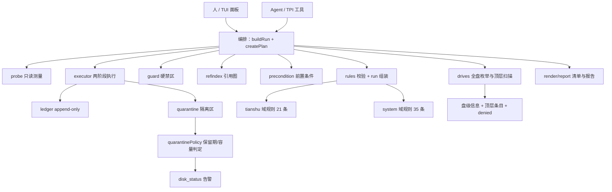

# disk-steward · 磁盘管家

天枢（Tianshu）插件：**把"清理磁盘"做成一条可审计的流水线** —— 扫描 → 分级并逐项解释 → 人勾选 → 两阶段执行 → 每一步落台账、可撤销。

扫描只读。任何真正的删除都必须先经过人工确认；任何"能删"的判断都必须能说出理由；任何"不删"的东西也必须说清为什么。

## 核心立场（三条不变量）

1. **无执行器即被拒**：`item.executor` 为 `null` 的项永远进不了计划。
2. **只有 `stage | migrate` 进清理集**：`compact` 只压实不动文件，把它 stage 走等于破坏活数据库。
3. **人批准是独立事实**：令牌只是能力凭证，`issuer === 'human'` 且 `confirmedBy` 非空才允许动磁盘。

规则库刻意是**白名单**：只列能解释清楚的路径，不用通配符扫系统目录。看到清单之外的路径，插件的诚实回答是"不认识，所以不动"。

## 双域 + 全部盘

| 对象 | 管什么 | 执行资格从哪来 |
|---|---|---|
| **tianshu 域** | 天枢自身的数据（`~/.rivet` 与项目 `.rivet`）：scratch、临时区、HTTP 缓存、备份、历史产物 | 规则文件直接声明 `executor` |
| **system 域** | 操作系统侧的缓存与临时区：`%TEMP%`、`%LOCALAPPDATA%\Temp`、`%WINDIR%\Temp`、Chrome/Edge 缓存 | `scanSystem({ execEnabled: true })` 授予；工具面已开启，TUI 需 `--with-system --allow-exec` |
| **全部盘（只读）** | 当前设备上每一个逻辑盘的容量、顶层条目、可选占用排序 | 不授予执行资格——盘级信息与未收录路径一律按保护处理 |

前两个域回答"哪些东西可以删"，第三项回答"这台机器上到底有哪些盘、各占多少"。三者可以一次扫描同时拿到。

---

## 当前状态（每个数字都在 2026-11-17 现场核对）

| 项 | 数值 | 怎么核 |
|---|---|---|
| 工具 | **9** 个 | `createTools().length`；名字见「工具面」节 |
| 测试 | **247 用例 / 53 个文件**，全绿 | `npm test`（`scripts.test = node --test`），exit 0，约 184s |
| 类型检查 | `tsc --noEmit` **exit 0** | `../node_modules/.bin/tsc --noEmit` |
| 规则 | 天枢域 **21** 条、系统域 **35** 条 | `rules/tianshu.rules.json`、`domains/system.mjs` |
| 硬禁区 | **9** 类（`core/guard.mjs` 的 `DENY`） | 逐条见「安全模型」节 |
| 代码量 | **81 个 `.mjs` / 7287 行**（含测试；生产代码 31 个） | `find . -name '*.mjs' -not -path './node_modules/*' \| wc -l` |
| 台账 | `<dataDir>/runs/ledger.jsonl` **32 行**：`intent` 11、`stage` 10、`batch` 3、`undo` 1、`abort` 1、`purge` 6 | 该文件按 `action` 计数 |

台账是运行期数据，数字会随使用变化；上表是核对时刻的快照，不是恒定值。

---

## 快速开始

工作目录 `disk-steward/`。运行代码零依赖；类型检查依赖仓库根的 `typescript` 与 `@types/node`。要求 Node.js >= 22（`engines`；引用图用 `node:sqlite`，盘符枚举用 `fs.statfs`）。

```bash
# 测试（247 用例 / 53 文件）
npm test                       # 等价于 node --test
node --test test/w36.test.mjs  # 单文件

# 类型检查
../node_modules/.bin/tsc --noEmit

# 只读扫描 + 文本面板（参数是项目根，用于解析 {{projectRivetHome}}）
node bin/scan.mjs D:/Februus

# 交互面板：勾选 → 预览计划 → 确认 → 执行 → 撤销
node bin/tui.mjs --only-project                # 只展示项目域条目
node bin/tui.mjs --only-project --allow-exec   # 允许真正 stage（仍需 x→y 二次确认）
node bin/tui.mjs --with-system --allow-exec    # 连系统域一起（默认关闭）
node bin/tui.mjs --script "axy"                # 无人值守回放按键（_ 代表空格）
node bin/tui.mjs --project D:/somewhere        # 指定项目根

# 隔离区：查看 / 人工永久删除
node bin/purge.mjs                                       # 打印批次数、项数、体积、最老天数
node bin/purge.mjs --batch <batchId>                     # 交互确认 [y/N] 后永久删除
node bin/purge.mjs --batch <batchId> --yes --by <name>   # 跳过交互（显式署名）
```

TUI 按键：`j/k` 移动 · `空格` 勾选 · `a` 全选可勾项 · `c` 清空 · `f` 循环过滤（全部/可勾/受保护/被挡）· `d` 详情 · `p` 预览计划 · `x` 进入确认页 · `y` 确认执行 · `n` 取消 · `u` 撤销本会话批次 · `q` 退出。

---

## 全部盘扫描

盘符不写死、也不靠 shell：`core/drives.mjs` 对 `A:`–`Z:` 逐个 `statfs`，成功的才算存在（实测本机 26 个盘符共 **2ms**，不存在的盘符 1ms 内 `ENOENT`）。不调用 `wmic` / PowerShell，不创建任何文件。

`domains/drives.mjs` 的 `scanDrives()` 有两档：

| 档 | 做什么 | 成本 | 拿到什么 |
|---|---|---|---|
| `summary`（默认） | 每盘 `readdir` 顶层 + 容量 | 每盘毫秒级 | 盘符、总容量、可用、顶层目录/文件数、顶层条目清单 |
| `deep` | 再对每个顶层项 `measure()` 递归求占用 | 受 `budgetMs` 约束（默认 15s，**按盘平摊**） | 顶层项按字节降序排行 |

三条实现约束，都是实测踩出来的：

- **junction 先挡**：`C:\Documents and Settings` 是指向 `C:\Users` 的 junction。`measure()` 只跳过链接*内部*的内容，不跳链接本身，所以顶层必须先按 `isSymbolicLink()` 排除——否则会把整个用户目录重复算一遍（实测虚报 **139 GB**，单次递归耗 139 秒）。
- **预算按盘平摊**：早先是一个全局 deadline，C 盘吃光后 D 盘 126 个顶层项全部未测。改为 `budgetMs / 盘数` 后，D 盘在 7.5s 内测到 59 项。
- **禁区先挡后测**：回收站、`System Volume Information`、`Windows` 目录在测量**之前**就被 `guard` 拦下，只进 `denied` 列表，不进清单、不被遍历。

超预算或部分遍历时标 `partial` / `unmeasured`，不静默少报。

工具面调用方式：

```
disk_scan({ allDrives: true, driveDepth: 'summary' })   # 盘级概览，秒级
disk_scan({ allDrives: true, driveDepth: 'deep' })      # 顶层占用排行榜，约 15s
```

结果挂在 `run.drives`（`{ deep, drives[], denied[], truncated }`），摘要里多一段 `[全部盘] C: 74.9 GB/300 GB 可用｜D: 34.9 GB/165 GB 可用；深扫=false｜禁区拦截 13 条`。

`disk_status` 无参数即列出所有盘：

```
磁盘 C:  300 GB 共 / 74.9 GB 可用  (已用 75%)
磁盘 D:  165 GB 共 / 34.9 GB 可用  (已用 79%)
```

**能力边界（重要）**：非系统盘上，本插件能"清理"的仍然只有项目自己的 `.rivet`。回收站与 `System Volume Information` 是硬禁区（见下），所以对 D/E 盘这类外盘，插件交付的是**看得见占用**，不是**能替你删**。

---

## 安全模型

```
无执行器即被拒：item.executor 为 null 的项永远进不了计划
   ↓ 天枢域由规则声明 executor；系统域由 scanSystem({ execEnabled: true }) 授予资格
只有 stage / migrate 进清理集（compact 只压实不动文件）
   ↓ 用户勾选 → 预览计划 → x 进确认页 → y 确认
stage：移入隔离区（同卷 rename；跨卷退化为复制+删，标 crossVolume）
   ↓ 再次确认 + 一次性令牌 + 已 staged 校验
purge：永久删除，只限本批次已 staged 的项
```

- **令牌**：`createPlan` 签发，10 分钟 TTL；`stage` 与 `purge` 都校验令牌与过期时间，令牌一次性。
- **人工批准**：`stage` / `purge` / `purgeBatch` 要求 `issuer === 'human'` 且 `confirmedBy` 非空。工具面通过 `disk_exec` 的 `approval` 取得这一事实；TUI 与 `bin/purge.mjs` 由本地键入提供。
- **计划拒绝条件**（`core/plan.mjs`）：保护项（brown）/ 无执行器 / 非 `stage|migrate` / 被挡（`active`、`precondition`、`excluded`）/ **引用结论已过期**（`refsStaleSeconds > 0`）。
- **硬禁区**（`core/guard.mjs`，9 类，优先级高于规则库与用户决定）：Windows 系统目录、`Program Files*`、`ProgramData`、用户个人目录（文档/桌面/图片/视频/音乐/下载/OneDrive/AppData\Roaming）、`pagefile.sys`/`hiberfil.sys`/`swapfile.sys`、`$Recycle.Bin`、`System Volume Information`（卷影副本）、任意层 `WinSxS`、`Crypto\Keys` / `Microsoft\Protect`。字符串判定之外，执行前还会 `realpath` 解析真实路径再判一次（堵软链/junction）。
- **活跃窗口**：10 分钟内有写入（`mtimeGuard`）的项标记 `blocked: 'active'`，不进计划。
- **前置条件 fail-closed**：`processNotRunning` / `serviceStopped` / `fileExists` 不满足即阻塞；不认识的类型一律不通过。
- **执行期重验**：stage 前对每个目标取 dev+ino+size+mtime 快照，与扫描时对比；移动后再比一次，不符即回滚并记 `abort`。
- **引用图**：产物按 `expand: 'refs'` 展开为节点，被引用数决定分级；任何来源不可读 → 节点标 `refScanIncomplete` → **永不判 green**。增量索引 60s TTL，过期秒数写进 item，plan 层据此拒绝（遇到 `PLAN_REFUSED_STALE_REFS` 说明该重新扫描，删 `<宿主 dataDir>/runs/refcache.json` 可强制重建）。

---

## 架构



分层职责：**probe / drives 只读测量 → rules/run 纯函数分级与组装 → plan 闸门 → executor 唯一有写权限**。规则与执行器分离，"该不该"与"怎么做"互不纠缠。

全部盘扫描刻意**不进 item 清单**：盘与顶层目录不是可勾选的清理候选，塞进 `items` 会污染 `totals`（可勾选数、可释放字节）。它们的家是 `run.drives`。

---

## 工具面（9 个）

| 工具 | 只读 | 作用 | 关键约束 |
|---|---|---|---|
| `disk_scan` | ✅ | 扫描并落盘一次 run，返回 `run_id` 与最大 20 项 | 不写用户数据；`domain=system` 时按前置条件授予执行资格（被挡项仍为 `null`）；**默认脱敏**，`includeSamples: true` 才记样本文件名；`allDrives: true` 额外枚举全部盘（`driveDepth: 'deep'` 出顶层占用排序），结果挂 `run.drives` |
| `disk_status` | ✅ | 全部盘的容量与已用率 + 关键目录存在性 + 隔离区状态 | 不递归遍历；隔离区行附「过期 N 批」「超限 X > Y」告警，只提示不删除 |
| `disk_rules` | ✅ | 解释某路径命中哪条规则、为什么是该分级 | 未命中 → "按保护处理（brown）" |
| `disk_report` | ✅ | 把一次扫描渲染成 Markdown 清单 | 只读；落 `.runs/<run_id>.md`，含逐项域标注与 id |
| `disk_diff` | ✅ | 两次扫描增量（变大/变小/新增/消失） | 分项之和等于总量差 |
| `disk_plan` | ✅ | 生成计划并签发一次性令牌 | 保护项 / 被挡项 / 非 stage 类 / 引用过期一律拒绝 |
| `disk_exec` | ❌ | `stage` 移入隔离区（可撤销）/ `purge` 永久删除 | 必须带 `approval`（用户在对话里同意执行的原话），缺它一律拒绝；`purge` 只限本批次已 staged 项 |
| `disk_undo` | ❌ | 按批次反演撤销 | 目标已存在则跳过并说明，不猜测 |
| `disk_recover` | ✅ | 崩溃恢复：补齐「只写了 intent、终态行没落」的批次账目 | 只改台账，不移动、不删除任何文件（因此不需批准）；不给 `batchId` 则列出未决批次 |

「人批准过」这个事实由**对话**提供：`disk_plan` 仍以 `issuer: 'agent'` 签发；agent 必须先把计划逐项给用户看，用户明确同意（例如回复「批准」）后，把**用户原话**作为 `approval` 传给 `disk_exec`。工具层校验 `approval` 非空后才把计划升格为 `issuer: 'human'`、`confirmedBy: 'chat:<原话>'`。

- 缺 `approval`（或只有空白）→ `EXEC_NOT_HUMAN_APPROVED`，不移动任何文件、不写台账。
- 台账 `intent` / `stage` 行留下 `issuer: 'human'`、`confirmedBy: 'chat:批准'`，事后可追溯。

**强度差异**：TUI（`confirmedBy: 'tui'`）与 `bin/purge.mjs` 是本地人当场键入，批准事实由人直接产生；工具面的 `approval` 由 agent 转述，挡得住"模型没问就执行"，挡不住"模型编一句批准"。要让机器可验证，得由宿主批准 UI 提供事实。

---

## 清单与报告（`disk_report`）

一份报告回答两个问题：**删的是什么**、**不删的为什么不被删**。条目分四个桶穷尽覆盖：

| 桶 | 判据 | 说明 |
|---|---|---|
| 可勾选 | `isStageable`：非 brown、未被挡、`executor ∈ {stage, migrate}` | 逐项列 `id` / 域 / 路径 / 分级 / 是什么 / 为什么 / 重建 / 副作用 / 撤销 |
| 被挡住 | `item.blocked` 非空 | 附 `blockedReason`，如「10 分钟内有写入（可能仍在使用）」 |
| 可见但不可执行 | 非 brown 且 `executor` 不在清理集 | 如 WAL 只能 checkpoint、名称不具判别力的产物 |
| 受保护 | `grade === 'brown'` | 单行带 `[域]` 前缀与原因 |

另外两段：**未收录路径**（规则库未覆盖 → 一律不清理）、**禁区拦截**（硬禁区，连扫描都不进入）。域归属由规则 id 前缀判定（`sys.*` / `ts.*`），渲染时不做二次猜测。

报告暂不渲染 `run.drives`——全盘数据目前只在 `disk_scan` 摘要与 `run.drives` JSON 里。

---

## 规则库格式

```json
{
  "id": "ts.scratch",
  "title": "一次性探针产物（全局 scratch）",
  "detect": { "kind": "exists", "path": "{{rivetHome}}/scratch" },
  "match":  { "kind": "prefix", "path": "{{rivetHome}}/scratch" },
  "grade": "green",
  "reason": "scratch 是约定的一次性区，清后不影响 knowledge/plans/memory",
  "rebuild": "无需重建",
  "precondition": { "kind": "processNotRunning", "name": "msedge" },
  "sideEffect": null,
  "needsElevation": false,
  "executor": { "type": "stage" }
}
```

| 字段 | 作用 | 缺省行为 |
|---|---|---|
| `detect` | 前置存在性。不命中则**整条规则不参与扫描**（连测量都不做） | 无 → 恒参与 |
| `match` | 目标（前缀匹配，按路径段边界、分隔符无关） | 必填 |
| `exclude` | 规则内排除，优先级高于 `match`：命中则降级 brown、不可执行（仍出现在清单里） | 无 |
| `flags` | `keepDir`（移走内容后重建空源目录）/ `noRecurse`（只移直接子文件）/ `recurse`·`removeSelf`（允许值，当前不改变行为）。未知值让规则校验失败 | 整目录移走 |
| `grade` | `green / yellow / orange / blue` 可执行；**brown = 保护，禁止出现 `executor`**（否则 `RULE_BROWN_HAS_EXECUTOR`） | 必填 |
| `reason` | 人读的判定理由（`explain.why` 的来源） | 必填，空值即校验失败 |
| `rebuild` | 删后如何重建 | 无 |
| `precondition` | `processNotRunning` / `serviceStopped` / `fileExists` | 无前置 |
| `sideEffect` | 人读的副作用 | 无 |
| `needsElevation` | 标记需要管理员权限（只判定与构造命令，不自动提权） | false |
| `executor` | `stage` / `purge` / `migrate` / `compact` | 非保护级必填 |
| `mtimeGuard` | 设为 `false` 可关闭"10 分钟内有写入即阻断" | 开启 |
| `expand` | 设为 `'refs'` 时按引用图展开为多个产物节点 | 单项目 |

`keepDir` / `noRecurse` 按**文件粒度**记账（`file-intent` + `file-stage`），`undo` 逐文件反演，目标文件已存在则跳过并在报告里说明。

---

## 台账与撤销

默认路径 `<宿主 dataDir>/runs/ledger.jsonl`——真机由 `activate(host)` 用 `host.storage.dataDir()` 注入；非宿主调用（测试、`bin/` 下的 CLI）落 `%USERPROFILE%\.rivet\plugins\disk-steward\data\runs`，推导只有一处（`core/paths.mjs`）。append-only，一行一次状态变更：

```json
{"ts":1793807474110,"batchId":"b-mw2anlbyd55c16","action":"stage","itemId":"ts.cache#1",
 "from":"D:/tmp/.rivet/scratch","to":"…/.trash/b-mw2anlbyd55c16/…","bytes":21,
 "crossVolume":false,"undoSupported":true}
```

- 动作类型：`intent` → `stage` / `abort`；文件粒度另有 `file-intent` → `file-stage` / `file-abort`；`undo`；`purge`；`batch`（汇总行）。
- **目录粒度**（默认）：`undo` 反向 rename，跨卷退化为复制+删。
- **文件粒度**（`keepDir` / `noRecurse` 等）：先记 `file-intent` 再动磁盘，逐文件 `file-stage`；目录行标 `undoSupported: false`（只作审计），撤销靠逐文件反演。
- **崩溃恢复** `recoverBatch({ ledgerPath, batchId })`：只看 intent 与终态的差集。入口有两个：工具面 `disk_recover`（不给 batchId 则列出全部未决批次）与 `bin/recover.mjs`；两者都只补记账、不动磁盘，因此不需要人工批准。`disk_status` 会把未决批次数列出来。
  - 目标在、源不在 → 补记 `stage`（`recovered: true`）；
  - 源与目标都在 → 判 `inconsistent`，保留现场交给人判断，**不自动删任何一边**；
  - 源在、目标不在 → 记 `abort`。
- **重启后释放** `purgeBatch({ batchId, ledgerPath, quarantineRoot, approval })`：只凭台账 + 人工批准，不依赖内存中的 plan；台账里每条目标路径必须落在 `quarantineRoot` 之下，否则抛 `EXEC_BATCH_PATH_ESCAPE`。

已知细节：`undo` 与 `purge` 都会把批次目录里的内容处理干净，但**不删批次目录本身**（会留 0 条目的空壳）。不影响台账与统计口径。

---

## 隔离区策略与隐私

**策略只判定，不执行**：

- `quarantineStats` → `{ batches, items, bytes, oldestDays }`；只统计"文件仍真实存在且未 purge"的条目（undo 回去的不再占额度）。
- `quarantinePolicy` → `{ batches, bytes, retentionDays, maxBytes, expiredBatches, overLimit }`，默认保留期 **7 天**、容量上限 **2 GB**；**刻意不提供自动删除**（自动删等于绕过人工确认）。
- `disk_status` 把两者拼成一行并附告警，例如：

  ```
  隔离区              1 批 / 3 项 / 19.6 MB / 最老 0 天（node bin/purge.mjs 释放）
  ```
- 释放走 `bin/purge.mjs`（人工确认）或 `disk_exec mode=purge`。

**隐私默认值**：

- `buildRun` 默认 `vars.includeSamples !== true` → `item.samples = []`、`samplesRedacted: true`；真实文件名不进入 run，也不进入解释文本。
- 唯一开关是 `disk_scan` 的 `includeSamples: true`（会随 run 落盘到 `.runs/<run_id>.json`）。
- 引用图节点的 `samples` 恒为空；系统域条目不产出 `samples` 字段。
- 全盘扫描的 `top` 条目**始终带真实名字**（顶层目录名就是它要说明的东西，脱敏后没有意义）；`measure()` 只统计字节数，不收集文件名。

---

## 已验证 / 未验证

### 本轮实测（2026-11-06）

| 项 | 做法 | 结果 |
|---|---|---|
| 盘符枚举 | `listDrives()` 真机跑 A–Z | 26 个盘符 **2ms**；C: 300 GB / 74.9 GB 可用、D: 165 GB / 34.9 GB 可用；不存在的盘符 1ms 内 `ENOENT` |
| 全盘 summary | `disk_scan({ allDrives: true })` | 摘要含 `[全部盘] 2 个盘：…｜禁区拦截 13 条`；`run.items` 仍是 14 项（盘数据不污染清单） |
| 全盘 deep | `scanDrives({ deep: true })` 默认 15s 预算 | 耗时 **15.0s**（预算生效）；C 盘出真实排行（DrvPath 3.2 GB / Python314 979 MB / tmp 915 MB），D 盘出（BaiduNetdisk 1.7 GB / BaiduNetdiskDownload 1.6 GB / BackUp 1.1 GB） |
| junction 陷阱 | 直接扫 `C:\` 顶层 | 修前 `Documents and Settings` 虚报 **139 GB**、单次 measure 耗 139 秒；顶层按 `isSymbolicLink()` 跳过后消失 |
| 预算饥饿 | 两盘扫描对比 | 修前 D 盘 126 项全部 `unmeasured`；按盘平摊后 7.5s 内测到 59 项 |
| 全量测试 | `npm test` | 173 通过 / 0 失败，exit 0，31.7s |
| 类型检查 | `tsc --noEmit` | exit 0 |

### 历史记录（2026-11-05 实测，本次未复核）

真机删除曾跑通两批：Edge 缓存（467 MB + 325 MB + 544 KB，11409 文件进隔离区，purge 后 C 盘可用 76.3 → 77.1 GB）、9 个零引用历史产物（39 文件 / 582,748 字节）。`ts.backups`（3.9 MB / 114 文件）**未删**——它不可重建。

同批还验证过：系统域 stage → undo（沙箱与真机 GPUCache）、跨卷 stage 的 `EXEC_IDENTITY_CHANGED` 缺陷及修复（`w32` 覆盖，修复前 RED）、报告缺字段不泄漏 `undefined`/`null`（`w31`）、工具面 `approval` 通道（`w34`）。

当前 `.runs/ledger.jsonl` 只剩 20 行（`intent` 5 / `stage` 5 / `batch` 5 / `undo` 4 / `abort` 1，无 `purge`），历史批次的台账行已不在这个文件里。

### 仍未验证

- **缓存重建命中率**：删后 0.5s 内即出现新 GPUCache（约原体积 9%），真实浏览场景的命中率需要流量与 DevTools 统计，本环境无法测量。
- **`%TEMP%` 整体清理**：长期处于 `blocked: active`（10 分钟内有写入），从未真实删除过；17820 文件 / 2.5 GB 体量下的耗时尚无实测。
- **deep 全盘覆盖**：D 盘 126 个顶层项在 7.5s/盘下只测到 59 个；`budgetMs` 未暴露为 `disk_scan` 入参，要全测需改代码或直接调 `scanDrives`。
- **报告与 TUI 渲染 `run.drives`**：`render/`、`bin/`、`index.js` 对 `drives` 的引用为 0 命中，即未实现。
- **非系统盘的清理能力**：不存在——回收站与系统卷信息是硬禁区，外盘只有项目 `.rivet` 可清。
- **宿主侧最终形态**：插件在桌面端宿主里的加载与渲染，本次未复核。

---

## 宿主加载契约

清单在 `tianshu.plugin.json`（TPI 1.0），`package.json` 刻意**不带** `tianshu` 字段（4.0 明确拒绝旧式清单）。

必填：`$tpi`（`"1.0"`）、`kind: "tianshu.plugin"`、`id`、`displayName`、`version`、`description`、`runtime: "agent"`、`entry`、`capabilities: ["tools"]`、`contributes.tools`（≥1 个 `{ name, description }`）、`permissions`。

`permissions` 只接受三个可选布尔 —— `fs` / `net` / `shell`，宿主用 zod `.strict()` 校验。本插件声明 `{ "fs": true, "net": false, "shell": true }`，其中 `shell` 不是空声明：`core/precondition.mjs` 用 `spawnSync('tasklist' | 'sc.exe', …)`、`core/elevation.mjs` 用 `spawnSync('net', …)`。漏报会让插件中心展示的访问能力与实际行为不符。

**权限声明的效力边界**（宿主原文）："Declared permissions are advisory only and are NOT enforced at runtime." —— `permissions` 是**告知**而非**限制**；声明 `shell: true` 的价值在于如实暴露能力面。

入口模块必须 default（或 `plugin`）导出 `defineTianshuPlugin({ id, activate })` 的结果，工具由 `activate(host)` 返回（见 `index.js`）：

```js
export default sdk.defineTianshuPlugin({
  id: 'disk-steward',
  activate: () => ({ tools: createTools() }),
})
```

`activate` 返回的 `tools` 名字集合必须与 `contributes.tools` 排序后一致，否则 bind 阶段抛 `tools do not match manifest`。只 `export const tools` 会被判 `rejected_handshake`——插件中心照样显示，工具面永远为空。`createTools` 仍具名导出，供测试与脚本直接调用。

---

## 目录结构

```
disk-steward/
  tianshu.plugin.json      # TPI 1.0 清单（4.0 的唯一发现入口）
  package.json             # name/version/type: module/scripts.test —— 刻意不带 tianshu 字段
  index.js                 # 入口：default 导出 defineTianshuPlugin({ id, activate })
  tsconfig.json            # checkJs + noEmit
  tools/index.mjs          # 工具面：scan/status/rules/report/diff/plan/exec/undo
  core/
    probe.mjs              # 只读测量（字节/文件数/扩展名/样本/最新 mtime；支持 deadline 部分返回）
    rules.mjs              # 规则校验（brown 不得有 executor、reason 必填、flags 白名单）
    run.mjs                # 一次扫描 = 一份 run（detect/exclude/去重/unmatched/隐私）
    refindex.mjs           # 引用图（扫不全不判可回收，60s 增量缓存）
    guard.mjs              # 硬禁区（9 类 + realpath 复核）
    precondition.mjs       # 进程/服务/文件前置（fail-closed）
    plan.mjs               # 计划、一次性令牌、isStageable 唯一判据
    executor.mjs           # stage/purge/undo/recoverBatch/purgeBatch/quarantine*
    identity.mjs           # dev+ino+size+mtime 快照与移动后校验
    ledger.mjs             # append-only 台账
    diff.mjs               # 两次扫描增量
    occupancy.mjs          # 占用探测（不 rename 真实文件）
    elevation.mjs          # 提权判定与命令构造（不执行）
    explain.mjs            # "这里面是什么" 合成
    paths.mjs              # 路径归一化
    drives.mjs             # 盘符枚举（statfs 探测 A–Z，不调 wmic/PowerShell）
  domains/
    tianshu.mjs            # 天枢域目录语义与 vars
    system.mjs             # 系统域 35 条规则 + execEnabled 开关
    drives.mjs             # 全盘扫描（summary / deep，预算按盘平摊）
  render/
    table.mjs tui.mjs      # 列表/详情/勾选状态机（纯函数）
    confirm.mjs            # 删除确认页（是什么/多大/能否撤回 + [y/N]）
    report.mjs             # Markdown 清单与对比（含域标注与分域小计）
  rules/tianshu.rules.json # 21 条天枢域规则
  bin/
    scan.mjs               # 只读文本面板
    tui.mjs                # 交互面板（--allow-exec / --only-project / --with-system / --script）
    purge.mjs              # 隔离区人工释放（--batch / --yes / --by）
    recover.mjs            # 崩溃后补齐台账终态（--batch；不给则列出未决批次）
  test/                    # 53 个测试文件 / 247 用例
```

---

## 设计与调研文档

- `docs/系统流畅度与磁盘清理插件调研报告.md` —— 生态与架构调研（Winapp2 规则实测、五级分级模型）。
- `docs/调研补充-系统磁盘清理应用与边界对照.md` —— 五种规则库格式对照、共识禁区与分歧区。
- `docs/架构设计-disk-steward-双域磁盘清理插件.md` —— 不变量台账、分层架构、状态机、验收清单。

## License

未定（内部原型）。开发期依赖：`typescript`、`@types/node`（仅在仓库根目录，用于类型检查）。
